# photomosaic-nes

Build photomosaics from NES box art — each tile is a box art image matched by average colour.

**Try it live in your browser:** [adamstirtan.github.io/photomosaic-nes](https://adamstirtan.github.io/photomosaic-nes/)
— your webcam rebuilt in real time out of the same 695 box arts (WebGL2, nothing leaves your device).

## Examples

Each example shows the source on the left and the mosaic on the right.

**Super Mario Bros. 3 box art, rebuilt out of 695 NES box arts** (994x1360, 32 x 43 tiles at 32px, `--scale 2 --pick-from 5`):

<table>
<tr>
<td width="50%"></td>
<td width="50%"></td>
</tr>
<tr>
<td align="center"><em>Source</em></td>
<td align="center"><em>Mosaic</em></td>
</tr>
</table>

**The NES console, rebuilt out of the same 695 box arts** (2780x1510, 58 x 32 tiles at 48px, `--scale 0.5 --pick-from 12`):

<table>
<tr>
<td width="50%">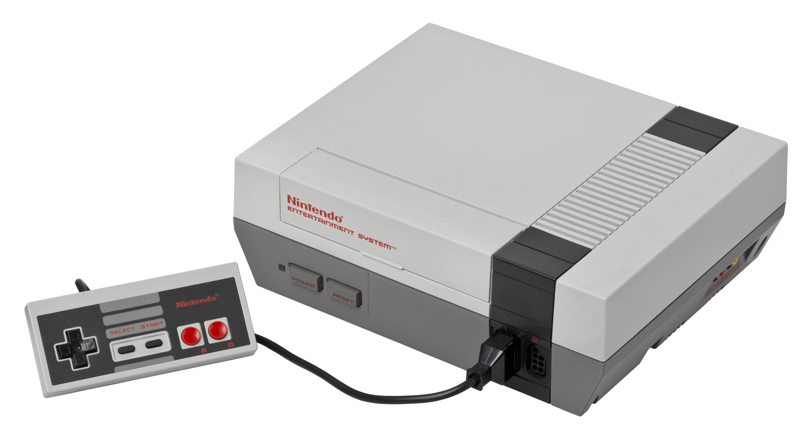</td>
<td width="50%"></td>
</tr>
<tr>
<td align="center"><em>Source</em></td>
<td align="center"><em>Mosaic</em></td>
</tr>
</table>

**Super Mario Bros. 3 poster, rebuilt out of the same 695 box arts** (1200x1800, 38 x 57 tiles at 32px, `--scale 1 --pick-from 5`):

<table>
<tr>
<td width="50%">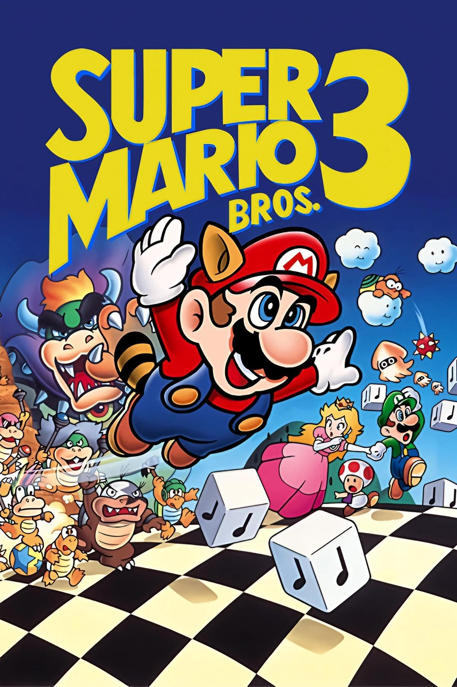</td>
<td width="50%"></td>
</tr>
<tr>
<td align="center"><em>Source</em></td>
<td align="center"><em>Mosaic</em></td>
</tr>
</table>

**Power Glove instructions cover, rebuilt out of the same 695 box arts** (877x801, 28 x 26 tiles at 32px, `--scale 1 --pick-from 5`):

<table>
<tr>
<td width="50%">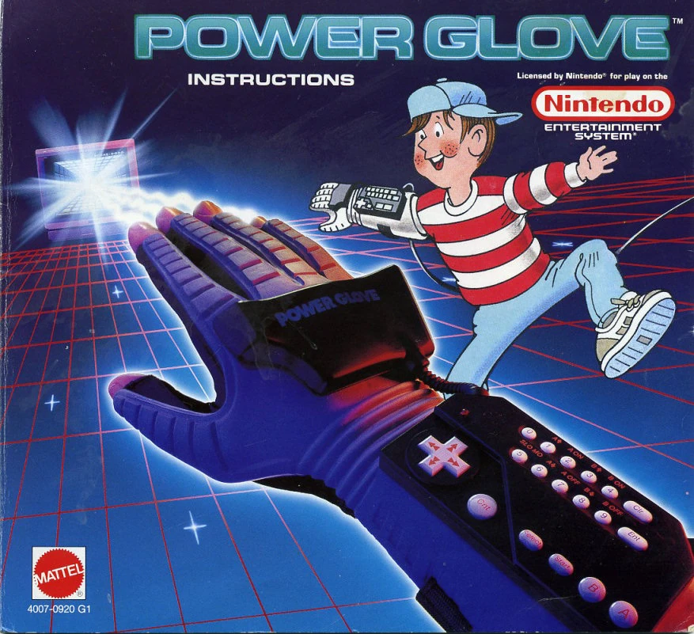</td>
<td width="50%"></td>
</tr>
<tr>
<td align="center"><em>Source</em></td>
<td align="center"><em>Mosaic</em></td>
</tr>
</table>

**The Wizard movie poster, rebuilt out of the same 695 box arts** (1000x1426, 32 x 45 tiles at 32px, `--scale 1 --pick-from 5`):

<table>
<tr>
<td width="50%">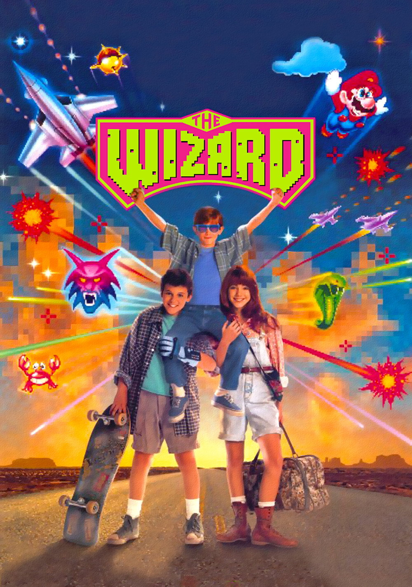</td>
<td width="50%">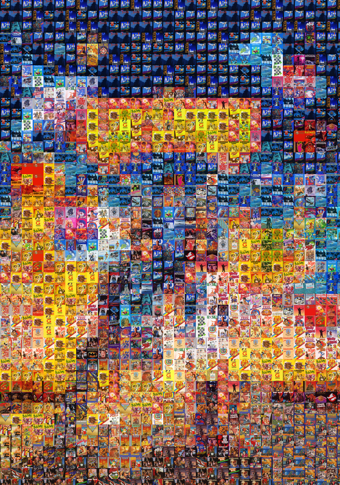</td>
</tr>
<tr>
<td align="center"><em>Source</em></td>
<td align="center"><em>Mosaic</em></td>
</tr>
</table>

**Lucas from The Wizard wearing the Power Glove, rebuilt out of the same 695 box arts** (866x706, 28 x 23 tiles at 32px, `--scale 1 --pick-from 12`):

<table>
<tr>
<td width="50%">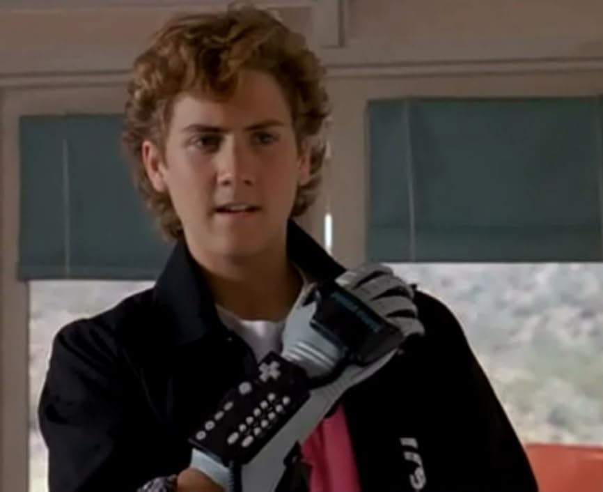</td>
<td width="50%"></td>
</tr>
<tr>
<td align="center"><em>Source</em></td>
<td align="center"><em>Mosaic</em></td>
</tr>
</table>

**A 90s kid at his NES setup, rebuilt out of the same 695 box arts** (1100x1084, 35 x 34 tiles at 32px, `--scale 2 --pick-from 12`):

<table>
<tr>
<td width="50%">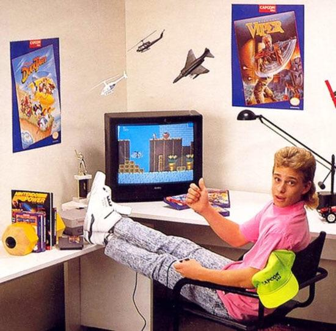</td>
<td width="50%">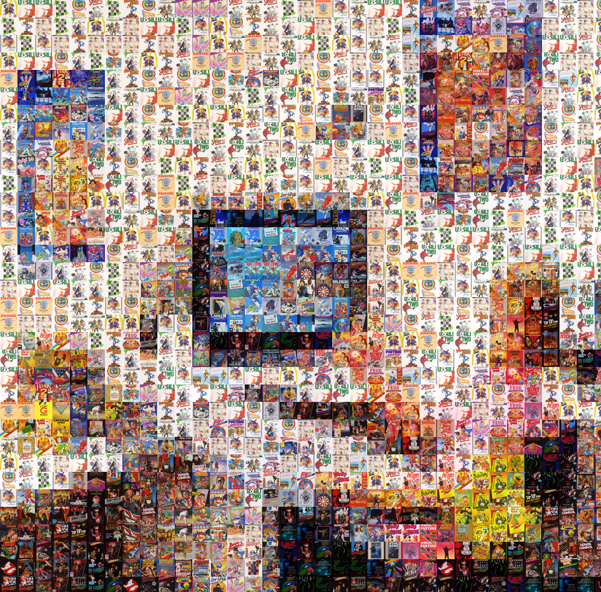</td>
</tr>
<tr>
<td align="center"><em>Source</em></td>
<td align="center"><em>Mosaic</em></td>
</tr>
</table>

**Link overlooking Hyrule (Breath of the Wild key art), rebuilt out of the same 695 box arts** (1920x1080, 60 x 34 tiles at 32px, `--scale 0.5 --pick-from 12`):

<table>
<tr>
<td width="50%">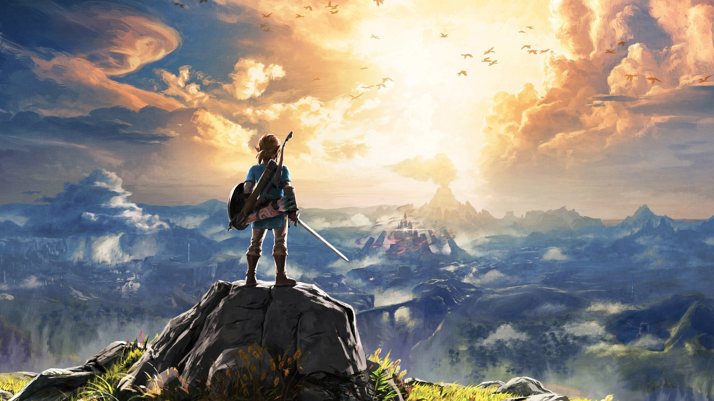</td>
<td width="50%">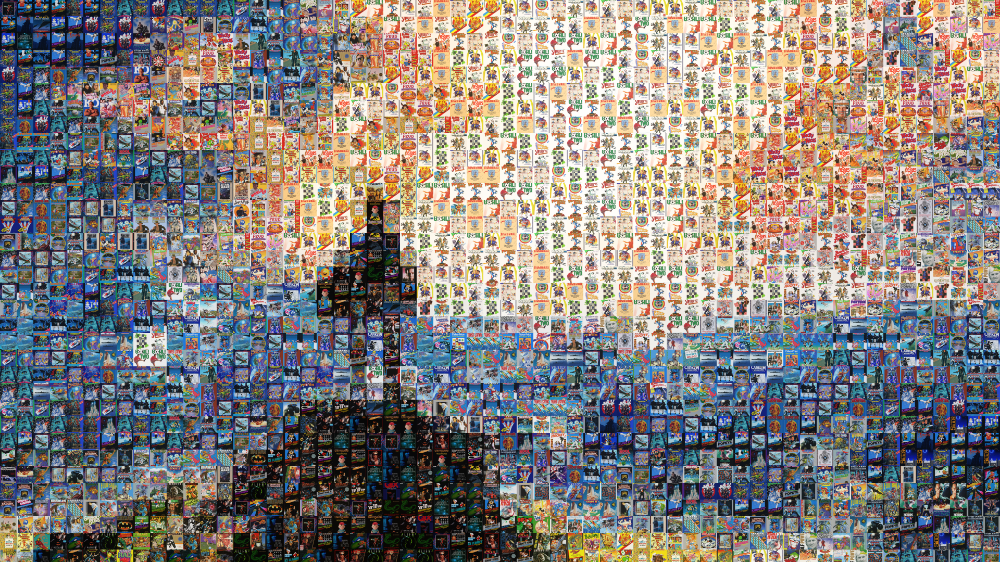</td>
</tr>
<tr>
<td align="center"><em>Source</em></td>
<td align="center"><em>Mosaic</em></td>
</tr>
</table>

**The same key art as a 3440x1440 ultrawide wallpaper, with even more cartridges** (160 x 69 tiles at 24px, `--scale 1 --tile-size 24 --pick-from 12`, cropped to 3440x1440):

<table>
<tr>
<td width="50%">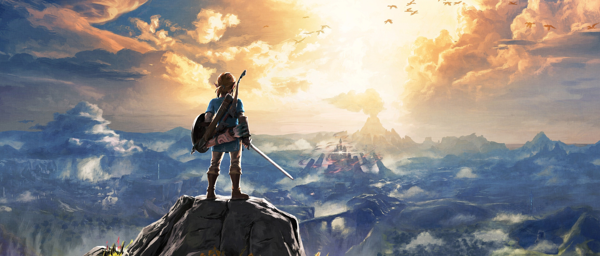</td>
<td width="50%">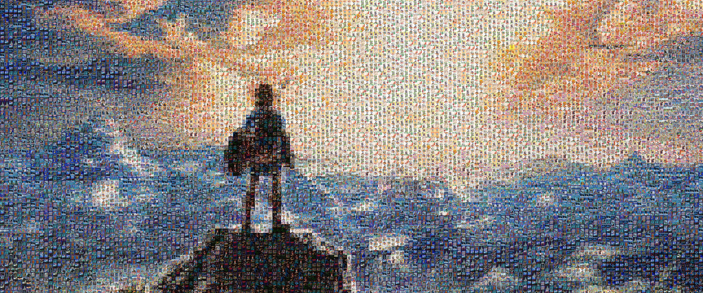</td>
</tr>
<tr>
<td align="center"><em>Source</em></td>
<td align="center"><em>Mosaic</em></td>
</tr>
</table>

**A Super Mario Bros. scene, rebuilt out of the same 695 box arts** (1212x692, 51 x 29 tiles at 24px, `--scale 1 --tile-size 24 --pick-from 12`):

<table>
<tr>
<td width="50%">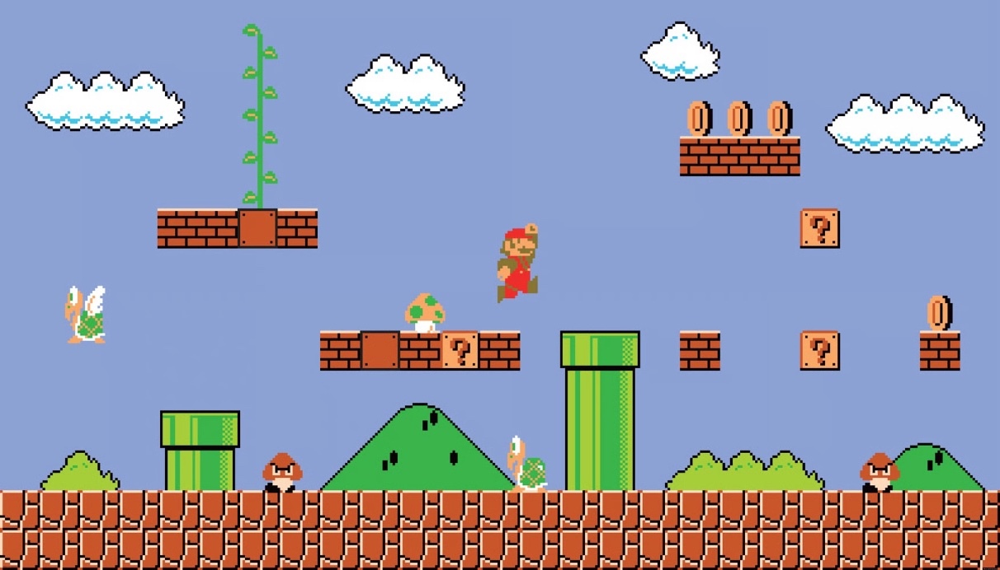</td>
<td width="50%">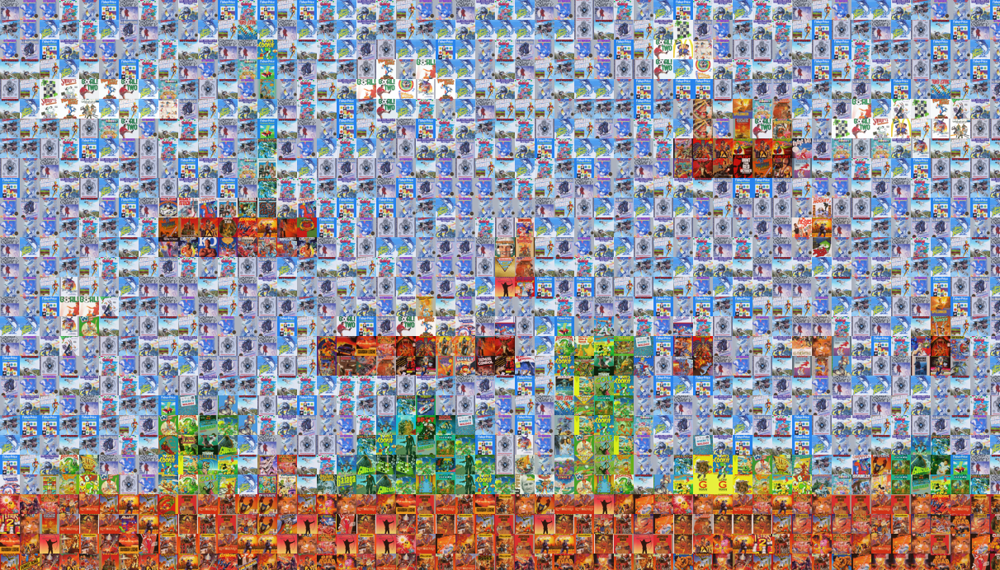</td>
</tr>
<tr>
<td align="center"><em>Source</em></td>
<td align="center"><em>Mosaic</em></td>
</tr>
</table>

**First test: a sunset, rebuilt out of 24 generated stand-in box arts** (640x480, 14 x 10 tiles at 48px):

<table>
<tr>
<td width="50%">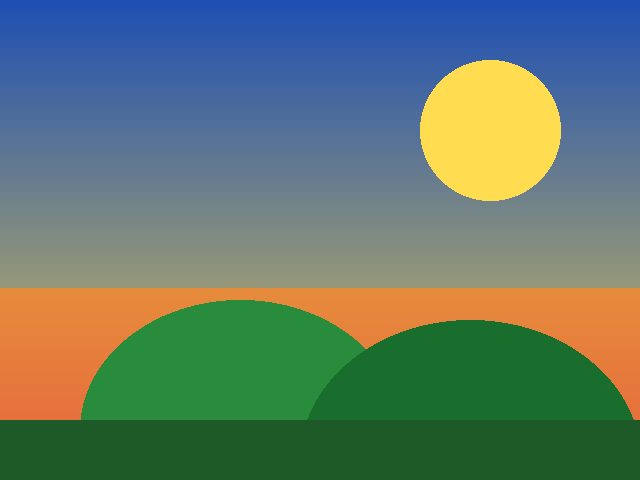</td>
<td width="50%"></td>
</tr>
<tr>
<td align="center"><em>Source</em></td>
<td align="center"><em>Mosaic</em></td>
</tr>
</table>

## Gameplay screenshots as mosaics

In-game screenshots work too — even at native NES resolution (256x224),
a high `--scale` turns them into print-size mosaics. Both of these are
2048px wide (`--scale 8 --tile-size 32 --pick-from 5`):

**Super Mario Bros. 3 — Raccoon Mario flying over World 1** (2048x1792, 64 x 56 tiles):

<table>
<tr>
<td width="50%">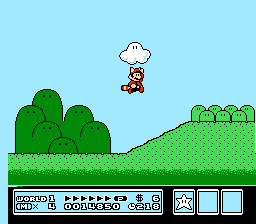</td>
<td width="50%"></td>
</tr>
<tr>
<td align="center"><em>Source</em></td>
<td align="center"><em>Mosaic</em></td>
</tr>
</table>

**Mike Tyson's Punch-Out!! — Little Mac vs. Glass Joe** (2048x1920, 64 x 60 tiles):

<table>
<tr>
<td width="50%">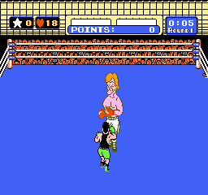</td>
<td width="50%"></td>
</tr>
<tr>
<td align="center"><em>Source</em></td>
<td align="center"><em>Mosaic</em></td>
</tr>
</table>

## How it works

Every box art image is reduced to its average colour. The source image is
split into a grid of tile-sized cells, and each cell is filled with the box
art whose average colour is closest to that cell's average colour. Tiles
may repeat — with a few dozen box arts, repeats are what make the mosaic
possible. Each tile is tinted slightly toward its target colour so the big
picture reads clearly while the box art stays visible.

## Build

Requires .NET 10.

```sh
dotnet build src/PhotomosaicNes/PhotomosaicNes.csproj -c Release
```

## Usage

```sh
dotnet run --project src/PhotomosaicNes -c Release -- <source-image> \
  [--tiles <dir>] [--output <file>] [--scale <factor>] \
  [--tile-size <px>] [--tint <0..1>]
```

| Option | Default | What it does |
| --- | --- | --- |
| `<source-image>` | — | The image to turn into a mosaic |
| `--tiles <dir>` | `./boxart` | Directory of box art images (png/jpg/jpeg/webp/bmp) |
| `--output <file>` | `./mosaic.png` | Where to write the mosaic |
| `--scale <factor>` | `1.0` | Output size relative to the source: 1.0 = same resolution, 0.5 = half, 2.0 = double |
| `--tile-size <px>` | `48` | How big each box art tile is drawn, in pixels. Smaller = finer detail |
| `--tint <0..1>` | `0.25` | How much to tint each tile toward its target colour (0 = raw box art, 1 = solid colour) |
| `--pick-from <n>` | `1` | Pick randomly from the n closest-matching tiles instead of always the best one. Higher values (e.g. 5) break up repetition in flat areas of the source — a plain white background otherwise fills with copies of the single whitest box art. Seeded, so runs are reproducible |

## Try it with the samples

The `samples/` folder has 24 generated stand-in box arts (colourful
patterns, one per hue) and a test source image, for a quick smoke test
without the real box art set:

```sh
dotnet run --project src/PhotomosaicNes -c Release -- \
  samples/test-source.png --tiles samples/boxart --output samples/test-mosaic.png
```

That produces a 640x480 mosaic (14 x 10 tiles at 48px). Try
`--scale 2 --tile-size 32` for a bigger, finer version.

## Try it with real box art

The `boxart/` folder holds 695 NES box arts — the complete licensed
North American library, as uniform 560x800 scans, used with permission.
If you clone this repo without them, `./fetch-boxart.sh` downloads an
equivalent working set from libretro-thumbnails (the set RetroArch uses,
listed in `boxart-urls.txt`); the file names differ from the curated set
committed here, but the tool only cares that the images are in `boxart/`:

```sh
./fetch-boxart.sh
```

Then run the mosaic against a real source image. Two are included in
`samples/`:

**Super Mario Bros. 3 box art** — a full-frame, colourful source with
almost no flat background, so it mosaics beautifully:

```sh
dotnet run --project src/PhotomosaicNes -c Release -- \
  samples/mario3-source.png --tiles boxart \
  --output samples/mario3-mosaic.png --scale 2 --tile-size 32 --pick-from 5
```

That makes a 994x1360 mosaic (32 x 43 tiles) in about 9 seconds.

**The NES console** — a public-domain photo of the console and
controller (`samples/nes-console-source.jpg`, 5560x3020, by Evan-Amos
via Wikimedia Commons). It works, but its big plain-white background
repeats the whitest box arts a lot — `--pick-from 12` helps, and a
colourful source like Mario 3 works better:

```sh
dotnet run --project src/PhotomosaicNes -c Release -- \
  samples/nes-console-source.jpg --tiles boxart \
  --output samples/nes-mosaic.png --scale 0.5 --pick-from 12
```

That makes a 2780x1510 mosaic (58 x 32 tiles) in about 10 seconds.

## Notes

- Box art images are centre-cropped to squares when drawn as tiles, so
  portrait box art loses a little off the top and bottom.
- Built with [SixLabors.ImageSharp](https://github.com/SixLabors/ImageSharp)
  3.1.12. (ImageSharp.Drawing was deliberately avoided — its v3 package
  needs a commercial licence.)
